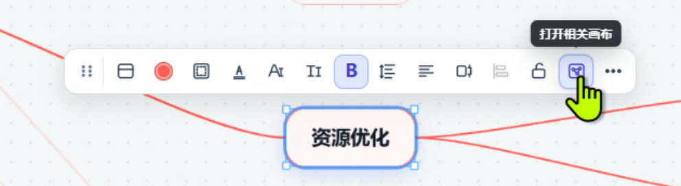
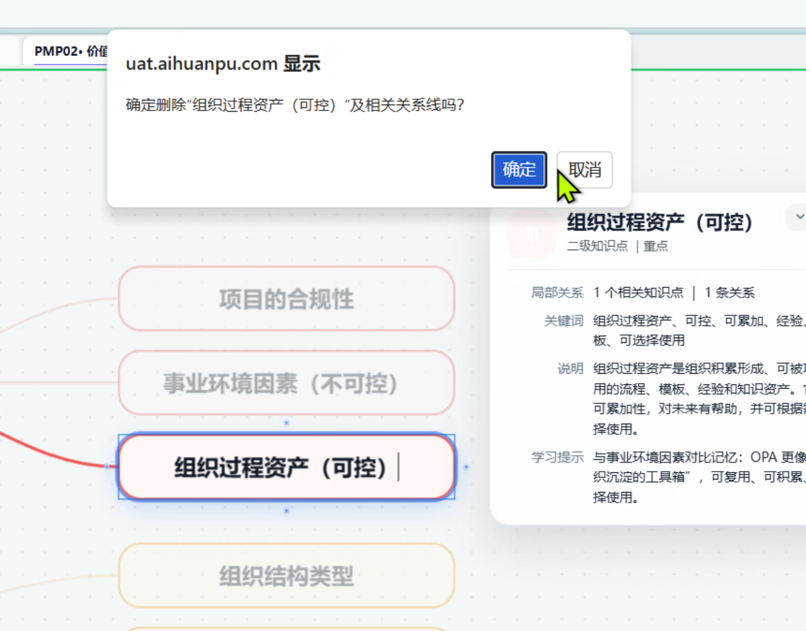
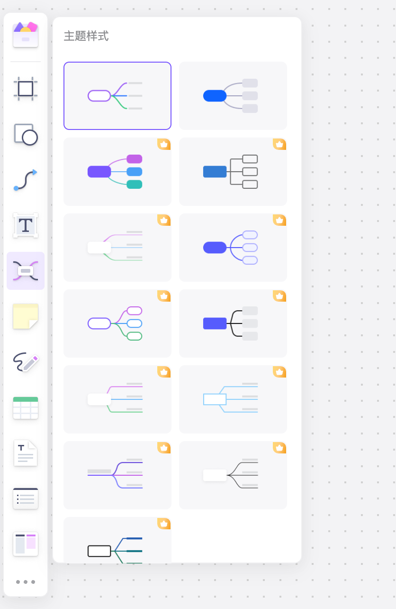
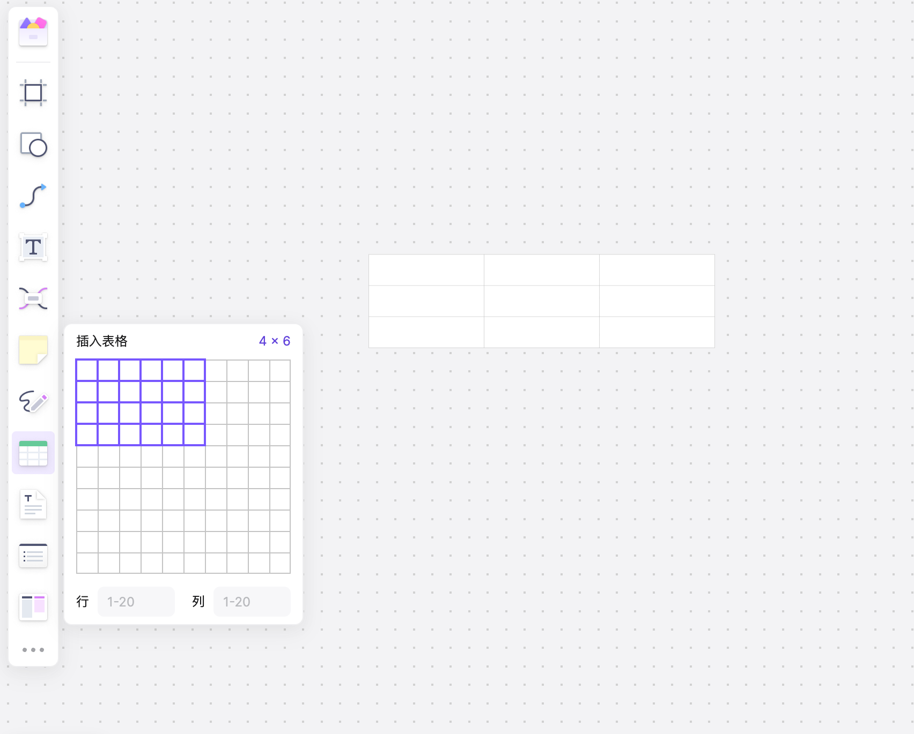
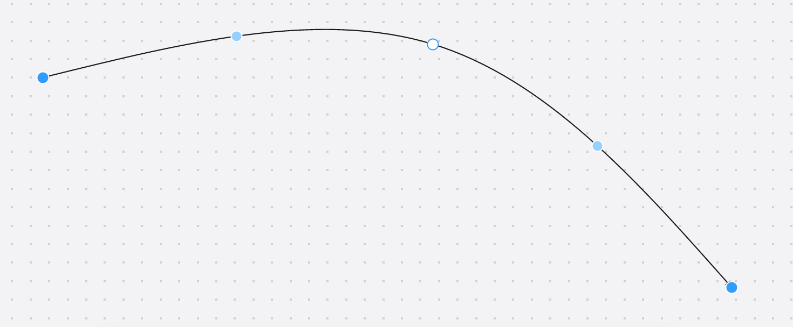

# 知识图谱、多题归纳与深度回忆需求文档

日期：2026-10-12

版本：1.0

状态：根据用户原始 16 条需求及后续澄清整理；尚未实施、尚未进行 UAT 业务验收。

用途：作为后续产品设计、技术方案、任务拆分、开发自检和用户验收的共同依据。

后续文档：[现有实现核查与推荐设计](2026-10-12-canvas-and-knowledge-graph-design.md) · [开发计划](2026-10-12-canvas-and-knowledge-graph-plan.md) · [任务清单](2026-10-12-canvas-and-knowledge-graph-tasks.md)。推荐设计中的新增参数尚不等于用户已确认，本需求正文保持原确认边界。

## 1. 文档依据与使用约定

本文保留原始需求编号 R01—R16。用户在澄清回复中使用的 1—10 编号是回答顺序，不替代原始需求编号。

依据包括：用户提供的 16 条需求、5 张参考截图，以及后续对端点、临时画布、XMind、主题、模板、题目权限、文字调整、背景和表格的确认。截图用于说明交互和故障，不代表截图中的全部功能均纳入本期。

“需求规则”描述本期应交付的行为；为使需求可验收而补充的异常处理和数据完整性要求也写在各条中。用户未指定的精确交互、规格数值和兼容清单，在第 7 节统一标为设计待定项，不视为用户已经确认。

本次交付仅为需求文档。文中的修复、新增和验证要求均是后续工作要求，不表示当前功能已经具备，也不表示已完成故障复现。

## 2. 目标与范围

### 2.1 用户目标

让知识图谱的连线、文字、全屏编辑和内容复用稳定可控；补充临时相关画布、XMind 导入、思维导图布局和模板能力；打通知识卡片与题目练习；改善多题归纳和深度回忆体验；在三个画布中提供一致的表格编辑能力。

### 2.2 需求总览

| 编号 | 需求 | 适用范围 | 性质 |
| --- | --- | --- | --- |
| R01 | 曲线上控制点与整体移动一致 | 知识图谱 | 交互调整、缺陷修复 |
| R02 | 手动固定卡片连接端点 | 知识图谱 | 新增能力 |
| R03 | 临时相关画布 | 知识图谱 | 新增能力 |
| R04 | 缩放时文字清晰 | 知识图谱、多题归纳、深度回忆 | 显示质量修复 |
| R05 | 导入 XMind `.xmind` 文件 | 知识图谱 | 新增能力 |
| R06 | 跨图谱文件复制 | 知识图谱 | 新增能力 |
| R07 | 思维导图布局与系统主题样式 | 知识图谱 | 新增能力 |
| R08 | 免费／会员模板中心 | 仅知识图谱 | 新增能力 |
| R09 | 全屏下打开详细信息编辑窗口 | 知识图谱 | 缺陷修复 |
| R10 | 卡片关联题目与右侧做题抽屉 | 知识图谱 | 新增能力 |
| R11 | 编辑文字时不触发整卡删除 | 知识图谱 | 缺陷修复 |
| R12 | 文字失焦保存与拖边调整大小 | 知识图谱文字编辑 | 交互调整 |
| R13 | 切换主题色保留原背景 | 多题归纳 | 行为修正 |
| R14 | 多选工具栏水滴颜色按钮可用 | 多题归纳 | 缺陷修复 |
| R15 | 未匹配知识点的关键词生成自定义卡牌 | 深度回忆 | 匹配修复、行为补全 |
| R16 | 可编辑表格 | 知识图谱、多题归纳、深度回忆 | 新增能力 |

### 2.3 本期边界

- 思维导图文件导入第一期仅支持 XMind 的 `.xmind` 格式。
- 连接端点采用上、下、左、右等预设位置，不要求卡片边缘任意位置吸附。
- 主题样式提供一批系统预设，本期不要求用户创建、发布个人主题样式。
- 模板中心仅覆盖知识图谱；仅管理员、教师发布，不经过审核，不开放普通用户发布。
- 临时相关画布关闭后丢弃，不回写原图谱，不要求另存为独立图谱。
- 表格支持 Excel 剪贴板粘贴，不等于增加 Excel 工作簿文件导入、公式计算或完整电子表格功能。
- 本期不要求重建页面框架、替换整套画布或改变已有页面的业务职责。

## 3. 角色、权限与数据边界

所有新增操作首先遵守当前页面和资源的查看／编辑权限。本需求只明确扩展模板发布、题库搜索及卡片关联题目的能力；不额外赋予修改他人图谱或题库的权限。

| 能力 | 管理员 | 教师 | 有效会员学生 | 非会员学生 |
| --- | --- | --- | --- | --- |
| 发布知识图谱模板 | 允许 | 允许 | 不允许 | 不允许 |
| 发布时设为免费或会员模板 | 允许 | 允许 | 不允许 | 不允许 |
| 加载免费模板 | 允许 | 允许 | 允许 | 允许 |
| 加载会员模板 | 按既有角色规则绕过订阅限制 | 按既有角色规则绕过订阅限制 | 允许 | 不允许 |
| 在卡片关联流程搜索全部题库 | 允许 | 允许 | 不允许 | 不允许 |
| 勾选、添加卡片关联题目 | 允许，须有当前图谱编辑权限 | 允许，须有当前图谱编辑权限 | 不允许 | 不允许 |
| 在有权访问的卡片抽屉内查看关联题、作答、查看解析 | 允许 | 允许 | 允许 | 允许，包括已关联的会员题 |
| 通过普通题库入口访问未关联会员题 | 沿用既有角色规则 | 沿用既有角色规则 | 沿用既有订阅规则 | 不因卡片关联而获得权限 |

补充规则：

1. “全部题库”是管理员、教师在关联题目流程中的搜索读取范围；包含会员题，不扩展为任意修改、删除全部题库。
2. 非会员学生访问会员题的例外，必须绑定其有权访问的图谱、卡片及有效关联关系，覆盖该题完整题干、选项、作答和解析。
3. 客户端隐藏入口不能替代服务端权限检查。修改题目 ID、卡片 ID、图谱 ID 或普通题库请求，不得扩大授权范围。
4. 会员模板与会员题目是两种独立授权：卡片题目例外不解锁会员模板或整个会员题库。
5. viewer、未登录访客沿用现有权限，本期不新增发布、关联或练习授权。
6. 除以上明确授权外，继续保持账号数据隔离；临时画布内容、练习记录和正式图谱内容分别遵守其所属业务的数据规则。

## 4. 详细需求与逐项验收

### R01 曲线上控制点与整体移动一致

**问题与目标**：当前通过曲线外的两个控制点调整线形，操作不直观；整体拖动后部分点位仍停留在旧位置。改为在曲线上直接操纵控制点，移动过程中保持形状和坐标一致。

**需求规则**：

- 选中可编辑曲线时，显示位于实际线条上的控制点，交互参考截图 5。
- 拖动控制点可以改变线形；拖动结束后控制点仍落在线上。
- 整体平移所选节点及其内部连线时，连线和控制点按相同位移移动，不残留旧点位。
- 平移画布、缩放视图不改变控制点与线条的相对关系；仅移动单个端点所属卡片时，连线应按新端点位置正确更新。
- 支持保存、重新打开及既有撤销／重做链路，不能只修正当前屏幕上的显示。

**验收标准**：

- AC01-1：选择曲线并拖动线上的控制点，线形随之改变，结束后点与线重合。
- AC01-2：同时选中两张卡片及其连线并整体移动，移动前后线形相对选区一致，无旧坐标残留。
- AC01-3：执行缩放、画布平移、保存重开及撤销／重做后，线条与控制点仍一致。

### R02 手动固定卡片连接端点

**需求规则**：

- 建立或编辑卡片连线时，允许分别选择起点卡片、终点卡片的预设连接位置，至少提供上、下、左、右。
- 手动选择后，固定的是卡片边界上的相对位置；卡片移动、文本变化或尺寸调整时，端点跟随卡片该位置移动，不自动换边。
- 保存并重新打开后仍保留两端的选择。
- 旧文件未配置固定端点时保持可用；自动连接与手动固定如何切换，在设计阶段明确，不将旧数据强制改为任意固定方向。

**验收标准**：

- AC02-1：将起点设为右侧、终点设为上侧，反复移动两张卡片，连接侧不改变。
- AC02-2：调整卡片尺寸、修改内容、缩放视图后，端点仍贴合选定边界位置。
- AC02-3：保存重开后固定设置保留，旧文件仍能打开和编辑。

### R03 临时相关画布

**需求规则**：

- 选中一个或多个知识卡片后，可打开临时相关画布，展示所选卡片及与其关联的内容，参考截图 1 的入口概念。
- 临时画布中的移动、文字、样式、连线和增删等内容修改均与原图谱隔离。
- 不自动创建正式文件，不回写原图谱，不把临时内容通过自动保存或退出流程写入正式数据。
- 关闭后直接丢弃本次临时修改；再次打开时从原图谱重新生成视图。
- 没有关联内容时仍显示选中的卡片，并给出清楚的空关联状态。
- 临时画布不能越过原图谱的可见范围加载其他无权访问的内容。

**验收标准**：

- AC03-1：打开相关画布，只出现规定关联范围内的内容，不把无关节点全部铺入。
- AC03-2：在临时画布中改名、移动、增删节点和连线，再关闭；原图谱内容及正式文件记录不变。
- AC03-3：重新打开不恢复上次临时修改；无关联节点的卡片也可正常打开。

### R04 三个画布缩放时文字清晰

**需求规则**：

- 知识图谱、多题归纳、深度回忆均须处理文字缩放模糊问题，覆盖节点／卡牌文字、关系文字、独立文本及新增表格文字。
- 在产品支持的缩放范围内，文字随实际显示比例正确呈现，不因放大已有低分辨率文字图像而持续模糊。
- 连续缩小后再放大，应恢复相同缩放比例下应有的清晰度，不能累积模糊。
- 普通窗口、全屏、不同设备像素密度下均应验证。
- 验收区分“字太小无法阅读”和“渲染失真”。不承诺在无限缩小或低于屏幕像素表达能力时仍可阅读，也不能以此为理由忽略正常缩放下的模糊。

**验收标准**：

- AC04-1：三个页面分别在支持的最小、最大、100% 和常用中间缩放比例检查中文、英文、数字，无异常重影或持续模糊。
- AC04-2：连续缩小、放大并回到 100%，清晰度与初始 100% 一致。
- AC04-3：在普通像素密度和高像素密度显示环境分别验证普通／全屏模式；记录截图与实际比例供用户验收。

### R05 导入 XMind `.xmind` 文件

**需求规则**：

- 提供 `.xmind` 文件导入入口，将内容转为可继续编辑的知识图谱，不能仅导入一张静态图片。
- 保留文字、主题层级、图片、备注和原有样式；样式至少应核对字体、字号、颜色、节点形状及连接线外观。
- 备注可通过卡片详情等合适入口查看、编辑，图片与对应主题保持关联。
- 导入失败、文件损坏或存在无法转换的内容时明确报告；不得静默丢弃图片、备注或样式后提示完整导入成功。
- 保存并重新打开后导入内容仍完整，不依赖原始文件的临时路径。
- 多工作表、不同 XMind 版本及特殊对象的兼容范围须以实际样本形成清单；不能仅凭扩展名声明全部版本完全兼容。
- 本期不增加其他思维导图软件格式；导入不应覆盖用户现有内容而没有清楚的目标和操作提示。

**验收标准**：

- AC05-1：导入包含多级主题、中文、图片、备注和不同样式的 `.xmind` 样本，逐项核对并可编辑。
- AC05-2：导入后保存重开，层级、图片、备注及已支持样式不丢失。
- AC05-3：对损坏文件、非 `.xmind` 文件和含不支持对象的样本给出准确反馈，原有图谱不被破坏。
- AC05-4：每类声明支持的 XMind 版本均有样本验证；任何保真缺口显式列出，不视为已满足“同时保留”。

### R06 跨知识图谱文件复制

**需求规则**：

- 支持复制当前图谱中选中的知识卡片，并粘贴到另一个有编辑权限的知识图谱文件中。
- 保留卡片正文、详细信息、图片、样式、尺寸、相对位置，以及所选卡片之间的连线和端点设置。
- 未选中节点不自动带入；指向未复制节点的连线不得在目标文件形成悬空引用。
- 粘贴后生成独立对象，修改目标卡片不回写来源；重复粘贴不发生对象标识冲突。
- 文本输入状态下的复制／粘贴继续处理文本，不能误触发图谱对象复制。
- 涉及关联题目时，复制不能伪造或扩大授权；具体迁移规则列入设计待定项。

**验收标准**：

- AC06-1：从文件 A 复制多张带内部连线的卡片到文件 B，内容、样式和内部关系完整。
- AC06-2：仅选部分卡片时，未选卡片及外部连线不形成错误副本或悬空引用。
- AC06-3：重复粘贴、保存重开、修改目标内容后，来源文件不变，目标对象互不冲突。
- AC06-4：在文字编辑状态下复制一段文字，只操作该段文字。

### R07 思维导图布局与系统主题样式

**需求规则**：

- 支持向左、向右、左右展开、向下树形四类布局。
- 布局改变节点位置和分支组织的显示方式，不能删除内容、备注、图片或已有业务关系。
- 增加一批可选择、预览的系统主题样式，参考截图 3 的样式选择方式；具体样式清单在设计阶段确定。
- 主题可体现节点外观、文字和连线样式差异，不要求本期开放用户自定义主题发布。
- 布局与样式可独立选择，保存重开后保留结果，沿用既有撤销／重做能力。
- 对包含环、多父节点或跨分支关系的图谱，必须明确布局处理规则，不能为套用树形布局而静默删除关系。

**验收标准**：

- AC07-1：同一层级样本切换四类布局，方向符合名称，内容和关系数量保持一致。
- AC07-2：选择不同预设主题后外观正确变化，正文、备注、图片和题目关联不丢失。
- AC07-3：含跨分支关系的样本不会因布局而丢线；保存重开、撤销／重做结果一致。

### R08 知识图谱模板中心

**需求规则**：

- 提供模板浏览和加载入口，模板至少可识别名称、预览及免费／会员属性。
- 管理员、教师可从有权发布的知识图谱生成模板，并选择免费或会员使用；发布不经过审核。
- 学生等其他用户本期不能发布模板。
- 免费模板可由符合既有访问条件的用户加载；会员模板面向所有有效会员，不额外区分付费档位；管理员、教师沿用现有订阅绕过规则。
- 加载后形成用户可以使用、编辑的图谱副本，编辑副本不改变模板或发布者原图谱。
- 本期模板仅覆盖知识图谱，不包含多题归纳和深度回忆模板。
- 加载失败或权限不满足时反馈明确，不能留下表面成功但内容不完整的副本。

**验收标准**：

- AC08-1：管理员、教师分别发布免费和会员模板，发布后可直接在模板中心使用，无审核等待环节。
- AC08-2：学生不能通过界面或直接请求发布模板。
- AC08-3：有效会员可以加载会员模板，非会员学生不能；免费模板按规则正常加载。
- AC08-4：加载后修改副本，模板及来源图谱均不变；保存重开后副本完整。

### R09 全屏下详细信息编辑窗口可用

**需求规则**：

- 知识图谱全屏模式中，点击卡片可以正常展开详细信息编辑窗口。
- 窗口应处于可见、可点击范围，支持输入、滚动、保存和关闭，不被画布或其他全屏层遮挡。
- 全屏进入／退出不会造成窗口失去焦点能力、消失、内容丢失或重复打开。
- 不依赖先退出全屏才能编辑。

**验收标准**：

- AC09-1：进入全屏后打开卡片详情，修改并保存，重新打开可看到修改。
- AC09-2：多次切换全屏，详情编辑、滚动、关闭及画布操作均正常。
- AC09-3：全屏下同时覆盖 R10 题目抽屉，界面层级与焦点不互相阻断。

### R10 知识卡片关联题目与右侧做题抽屉

**需求规则**：

- 打开知识卡片详情后提供“做题”入口，点击后在右侧抽屉展示已关联题目。
- 教师、管理员可以依据当前卡片知识点搜索全部题库，查看结果、勾选题目并确认关联；会员题也可被检索和选择。
- 卡片没有题目时，教师、管理员可从空状态进入搜索；已有题目时仍可继续添加。
- 重复选择已关联题目不产生重复关联；确认前的勾选不应提前改变正式关联。
- 学生只能对已关联题目进行查看、作答和查看解析，不提供搜索全题库、勾选或维护关联的权限。
- 非会员学生同样可以在有权访问的卡片抽屉中查看关联会员题的完整内容、作答和查看解析。该例外不能用于访问整个会员题库或未关联题目。
- 正确答案和解析沿用既有练习显示时机；“有权查看解析”不表示必须在作答前自动展示答案。
- 搜索结果为空时明确提示，不自动生成题目；学生打开无题卡片时显示暂无关联题目。
- 搜索失败、关联保存失败、题目失效等情况提供明确反馈，失败不能伪装成关联成功或无题。
- 服务端校验当前用户角色、图谱／卡片访问权以及题目关联关系。仅持有题目 ID 不足以获得卡片场景授权。

**主要流程**：

1. 教师或管理员进入可编辑图谱，打开卡片详情及题目抽屉。
2. 根据当前知识点搜索题目，勾选结果并确认，卡片关联列表更新。
3. 学生进入有权访问的图谱，点击卡片“做题”，在右侧抽屉完成练习并查看解析。
4. 学生通过其他题库入口访问题目时，继续执行该入口原有的订阅权限规则。

**验收标准**：

- AC10-1：教师、管理员均能搜索到不同题库及会员题，勾选确认后持久化关联；已有题目时可追加，不重复添加同一题。
- AC10-2：会员和非会员学生均可完成已关联题目的查看、作答与解析流程，包括会员题。
- AC10-3：非会员学生不能借此读取未关联会员题、访问无权访问的图谱，或通过普通题库接口扩大访问范围。
- AC10-4：学生直接调用搜索或维护关联的受限接口被拒绝。
- AC10-5：覆盖无题、无搜索结果、保存失败、题目不可用和全屏场景；界面状态与真实保存结果一致。

### R11 编辑文字时不触发整卡删除

**问题与目标**：截图 2 展示了编辑知识点文字时出现“删除知识点及相关关系线”的确认框。本需求修复文字编辑与画布删除快捷键的冲突，不等同于取消所有对象删除确认。

**需求规则**：

- 在标题、详细信息或其他文字输入区域内按 Backspace／Delete，只编辑文本，不触发节点或关系线删除。
- 覆盖选中文字删除、删除到空内容、中文输入法组合输入，以及富文本可编辑区域。
- 焦点不在文字编辑区且用户明确删除画布对象时，沿用对象删除的既有规则。

**验收标准**：

- AC11-1：原位编辑卡片标题并连续删字，不弹出整卡删除确认框，卡片及连线仍存在。
- AC11-2：在详情输入框、独立文本中删除选中文字和使用中文输入法，不删除画布对象。
- AC11-3：结束文字编辑后，明确删除选中节点仍按原有规则工作。

### R12 文字失焦保存与拖边调整大小

**需求规则**：

- 移除文字编辑专用的“保存／取消”按钮；点击当前输入区域外部后自动保存编辑结果。
- 自动保存失败时显示未保存状态并保留输入，不能直接关闭并丢失内容。
- 取消依赖滑轨调整文字大小的主要交互，改为拖动文本框四边调整。
- 拖动同时改变文本框宽高和字号；文字按新宽度自动换行，不裁切或丢失内容，不以单纯拉伸文字图像替代字号调整。
- 用户已明确两种效果都需要：既不是只改文本框，也不是只改字号。边框拖动与字号变化的具体映射在设计阶段明确。
- 输入过程中点击编辑器自身的格式工具不应造成误保存、误关闭或输入丢失。
- 该需求针对文字编辑，不据此删除其他业务表单、题目关联或详情窗口中的必要确认按钮。

**验收标准**：

- AC12-1：编辑文字后点击外部，无需保存按钮即可保存，重新打开内容一致；保存失败时输入仍可恢复。
- AC12-2：拖动四边分别测试尺寸变化和字号变化，长中文及中英文混排能够自动换行。
- AC12-3：调整后文字保持清晰，无内容丢失；保存重开后宽高、字号与换行结果一致。
- AC12-4：编辑文字时的删除行为继续满足 R11，操作文字格式工具不会误结束编辑。

### R13 多题归纳切换主题色时保留原背景

**需求规则**：

- 切换多题归纳主题色时，保留当前画布背景设置，包括已选择的背景颜色、图案或图片等已有配置。
- 主题色影响其应控制的卡片、连线和界面视觉，不隐式覆盖画布背景。
- 背景只能由用户明确的背景设置操作修改；反复切主题、刷新或重新打开后不应意外重置。

**验收标准**：

- AC13-1：设置背景后连续切换多个主题色，背景配置和可见效果保持不变。
- AC13-2：保存重开后主题色与背景均保持；显式修改背景仍然有效。

### R14 多题归纳多选工具栏水滴颜色按钮恢复可用

**已核实的入口含义**：当前源文件 `new-legacy/question-workspace.html` 中水滴图标按钮标注为“设置卡片或分组颜色”，动作是 `data-qw-selection-action="color"`；不是“打开相关画布”。`new-legacy/src/77-multi-question-workspace.js` 中存在颜色选择器调用。以上仅确认入口职责，尚未复现无响应故障或确认根因。

**需求规则**：

- 框选可编辑卡片后，点击水滴按钮正常打开颜色选择面板。
- 选择颜色后，按当前选区类型更新对应卡片或分组颜色，不能误改未选对象或画布背景。
- 不支持修改的选区应有明确禁用状态或提示，不能显示可用却无响应。
- 颜色面板不能被画布、浮动工具栏或全屏容器遮挡；操作面板时保持选区。

**验收标准**：

- AC14-1：框选多张可编辑卡片，点击水滴按钮可打开面板并完成颜色修改。
- AC14-2：覆盖卡片选区、分组选区、混合选区及其他不可编辑选区，根据明确的支持规则执行改色或提示，未选对象和背景不变。
- AC14-3：保存重开颜色保留，现有撤销／重做有效，全屏时面板可见可操作。

### R15 深度回忆未匹配关键词生成自定义卡牌

**需求规则**：

- 排查关键词与知识点的错误对应，不能因文本相近就绑定到不相关知识点。
- 能明确匹配的关键词继续使用正确知识点内容；没有匹配知识点时生成自定义卡牌，让用户自行填写。
- 自定义卡牌保留来源关键词作为填写上下文，明确表现为可编辑内容，不伪装为系统知识点卡牌。
- 用户填写后沿用深度回忆内容保存链路；重复打开不得把已填写内容重新替换为空白或不相关系统卡牌。
- 对多个候选或无法明确匹配的情况，设计阶段明确规则，不静默绑定不可靠候选。
- 历史错误匹配的修复不得覆盖用户已经手工填写的有效内容。

**验收标准**：

- AC15-1：已知正确匹配的样本展示对应知识点，不出现其他知识点内容。
- AC15-2：无对应知识点的关键词产生自定义卡牌，用户可填写、保存并在重开后继续编辑。
- AC15-3：近义、同名或多候选样本不被静默错误绑定，既有用户自定义内容不丢失。

### R16 三个画布的可编辑表格

**需求规则**：

- 知识图谱、多题归纳和深度回忆的画笔／画布工具区均增加表格入口，参考截图 4。
- 插入前可选择行数、列数，插入后可编辑单元格文字。
- 表格可整体移动和调整尺寸，随画布平移、缩放保持坐标一致，文字满足 R04 清晰度要求。
- 支持选择相邻矩形区域合并单元格；合并不得静默丢弃已有内容，具体内容合并顺序在设计阶段规定。
- 支持从 Excel 复制单元格区域并粘贴到画布表格，至少保留行列结构和显示文本，不把整片数据挤进单个单元格。
- 编辑单元格时，文本输入、删除和粘贴优先作用于单元格，不能误删整张表格或底层卡片。
- 保存重开后保留表格位置、尺寸、行列、单元格内容和合并关系；接入各页面已有的保存与撤销／重做机制。
- 三个页面使用一致交互，继续遵守各自编辑权限。表格在临时相关画布中的修改同样关闭即丢弃。

**验收标准**：

- AC16-1：三个页面分别插入指定行列的表格，输入中文和英文，移动、调整大小、缩放后显示正确。
- AC16-2：合并包含内容的相邻单元格，无静默内容丢失；保存重开后合并结构和内容保留。
- AC16-3：从 Excel 复制包含空单元格和多行多列数据的区域，粘贴后结构、文本正确。
- AC16-4：单元格编辑不触发画布对象删除或错误粘贴；只读状态不可修改。
- AC16-5：三个页面逐页验证保存、重开、撤销／重做，不能只验证其中一个画布。

## 5. 跨功能一致性与数据要求

### 5.1 内容完整性

- 新增固定端点、文字尺寸／字号、布局／主题、题目关联、表格等数据必须经过页面实际持久化链路；不能只在前端临时状态中生效。
- 旧文件缺少新增字段时使用兼容默认值，不导致加载失败或静默重置原有内容。
- 除 R03 明确要求的临时数据外，已保存数据在刷新、退出重进或切换文件后仍应恢复。
- 内容复制、模板加载、XMind 导入产生的独立内容不能共享可变引用而意外互相修改。
- 原有图片、备注、连线、练习数据及账号隔离不能因新增能力退化。

### 5.2 交互与异常

- 文字输入、画布快捷键、连线编辑、表格编辑、颜色面板及右侧抽屉要有清楚的焦点归属。
- 共享操作在普通模式、全屏模式及不同缩放比例下保持一致。
- 保存、导入、加载、搜索和关联失败时提供真实状态，保留必要输入，不以成功提示掩盖失败。
- 撤销／重做不得串到另一个文件或临时画布；临时画布关闭不得污染正式图谱历史。

### 5.3 工程约束

- 沿用 FastAPI 与原生 HTML/CSS/JavaScript 架构，前端权威源为 `new-legacy/`。
- 表格、文本编辑、缩放、坐标转换等有跨页面复用价值的能力优先扩展现有共享模块；不得在三个页面复制变体实现。
- 权限检查放在服务端公共业务入口，不通过放宽通用会员题库权限实现卡片场景例外。
- 不手工修改同步产物或 active release。后续发布遵循仓库现有发布、备份及 UAT 纪律。

## 6. 验证与交付要求

### 6.1 验证矩阵

| 维度 | 覆盖要求 |
| --- | --- |
| 页面 | 知识图谱、多题归纳、深度回忆按需求适用范围逐页验证 |
| 角色 | 管理员、教师、会员学生、非会员学生；viewer／访客作为权限回归 |
| 内容 | 旧文件、新文件、带图片备注的图谱、复杂关系图、空内容、长文本 |
| 视图 | 普通／全屏、缩小／放大、画布平移、高像素密度显示 |
| 保存 | 成功、失败、刷新恢复、重开、切换文件、临时内容丢弃 |
| 编辑 | 单选、多选、分组、输入焦点、中文输入法、撤销／重做 |
| 导入与复用 | XMind 样本、跨文件复制、免费／会员模板加载、Excel 粘贴 |
| 授权 | 界面入口和直接 API 请求均验证；卡片会员题例外不扩大授权 |

### 6.2 开发自检

后续实现时按变更范围运行现有前端同步／发布契约、设计契约、后端测试和相关浏览器验证：

```sh
cd frontend && pnpm test
cd frontend && pnpm test:design
cd backend && .venv/bin/python -m pytest tests/ -q
```

以上命令分别从仓库根目录执行，不串接为连续切换目录的单条脚本。跨页面功能必须在所有适用页面验证，不能用一个页面通过代表全部通过。

### 6.3 用户验收与发布边界

- 每项需求以 AC 编号登记“通过／未通过／未验证”，附页面、账号角色、样本和必要截图。
- 开发自检通过后按仓库纪律进入 UAT，用户本人确认业务验收；自动化或智能体自检不替代用户验收。
- 未经用户明确表示“验收通过”或“可以合入 main”，不得将功能合入或推送 main。
- 正式环境部署前按仓库要求备份代码和数据库并记录备份目录。
- 本文编写完成不触发实现、部署或发布，也不构成任何需求的验收通过。

## 7. 设计阶段需落定的细节

以下为尚未由用户指定的设计细节，不能擅自写成已确认范围。后续可结合现有实现提出默认方案，并在设计稿／技术方案中明确；它们不改变以上已确认的 16 项目标。

| 编号 | 关联需求 | 需明确的事项 |
| --- | --- | --- |
| D01 | R01、R02 | 曲线控制点数量及增删交互；固定端点与自动模式如何切换；单节点移动、自动布局时控制点的重算规则。 |
| D02 | R03 | 关联内容采用一跳还是更深层级、哪些关系类型纳入；临时画布内题目关联和作答入口是否开放，以及练习记录如何处理。无论采用何方案，临时内容均不得回写原图谱。 |
| D03 | R05 | 支持的 XMind 版本样本、多工作表处理、特殊对象和样式映射、导入目标与资源限制。保留图片、备注、样式的要求已确认，不得以待定为由直接省略。 |
| D04 | R06、R08、R10 | 卡片题目关联跨文件复制和模板发布／加载时的迁移规则、模板后续更新／下架，以及题目关联失效后的处理。授权必须由服务端验证，不能复制后自动扩大权限。 |
| D05 | R07 | 系统预设主题数量、具体样式；任意关系图转树形布局时的根节点、环与多父节点处理。截图中的会员标识不自动成为主题样式收费要求。 |
| D06 | R10 | 搜索使用哪些卡片字段、是否允许编辑搜索词、结果排序分页、已关联题排序／移除和练习记录归属；复用已有练习能力的具体范围。 |
| D07 | R12 | 四边拖动对宽高和字号的联合映射、最小／最大尺寸与字号、空文字的保存行为。不得只实现其中一种变化。 |
| D08 | R15 | 多候选关键词的判定规则、历史错误匹配的修复范围和保护用户自定义内容的方法。 |
| D09 | R16 | 行列上限、表格／行列尺寸调整方式、合并内容顺序、是否提供拆分、Excel 富格式／合并区域粘贴规则及超大粘贴处理。截图中的 1—20 行列限制不自动视为已确认上限。 |
| D10 | R04、R12 | 三个页面实际支持的缩放范围与清晰度测试环境；R12 是否同时涉及卡片标题和独立文本，以及是否复用到另外两个画布。 |

## 8. 参考截图索引

原始图片已作为本需求文档附件保留。图片中的产品控件仅作交互参考，以本文和用户明确澄清为准。

| 截图 | 内容 | 关联需求与解释 |
| --- | --- | --- |
| 1 | 选中节点后的工具栏，提示“打开相关画布” | R03 的入口参考；不是 R14 的故障按钮 |
| 2 | 编辑文字时出现删除整个知识点及相关关系线的确认框 | R11 的问题示例 |
| 3 | 思维导图主题样式面板 | R07 的系统预设样式参考；不自动引入截图全部收费规则 |
| 4 | 表格行列选择及画布表格 | R16 的插入交互参考 |
| 5 | 控制点位于曲线上的连线 | R01 的目标交互参考 |

### 截图 1：相关画布入口参考



### 截图 2：文字删除误触发整卡删除



### 截图 3：系统主题样式参考



### 截图 4：表格插入参考



### 截图 5：曲线上控制点参考


